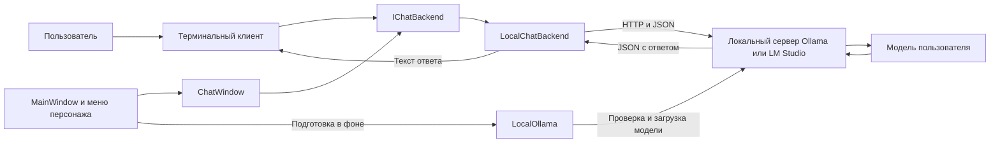

# Чат-бот DSP: техническая документация

Документ описывает текущую реализацию `Chatbot` и его подключение к WPF-помощнику
`dcp_project` на 5 ноября 2026 года. Версия 2: чат по кнопке, фоновая подготовка
Ollama и пиксельное отображение персонажа.
Все команды ниже выполняются из корня репозитория, если не указано другое.

## 1. Назначение и границы

Модуль предоставляет C#-интерфейс для текстового общения с моделью,
которую пользователь самостоятельно запускает на своём компьютере.
Есть два клиента: терминальный для отдельной проверки и окно чата WPF,
подключённое к контекстному меню персонажа. Быстрый запуск WPF описан в разделе 18.

Модуль умеет:

- подключаться к локальному HTTP(S)-серверу;
- получать идентификаторы доступных моделей;
- передавать модели сообщения и историю диалога;
- возвращать текст ответа;
- обрабатывать основные ошибки соединения, HTTP и формата ответа;
- отменять запрос через `CancellationToken`.

Библиотека `Backend` не устанавливает Ollama или LM Studio, не скачивает веса,
не запускает сервер и не обучает LLM. WPF-клиент отдельно умеет запустить уже
установленную Ollama и загрузить установленную модель в память.
Агентское выполнение команд, доступ к файлам через модель, БД, голосовой ввод
и TTS не реализованы.

Используется OpenAI-совместимый формат HTTP API. Это название протокола:
для работы не требуется GPT, аккаунт OpenAI или платный API OpenAI.
Проверенная локальная модель - `qwen3:4b-instruct` через Ollama.

## 2. Архитектура



| Компонент | Ответственность |
|---|---|
| `Terminal` | Ввод и вывод, выбор модели, команды, история текущего диалога |
| `MainWindow` | Персонаж, меню, создание скрытого чата, запуск подготовки модели |
| `ChatWindow` | Графический чат, история, отправка, отмена и очистка |
| `LocalOllama` | Предустановка подключения, запуск установленной Ollama и прогрев модели |
| `IChatBackend` | Контракт для клиента: список моделей и текстовый ответ |
| `LocalChatBackend` | Проверка конфигурации, HTTP-запросы, JSON и ошибки сервера |
| Ollama / LM Studio | Загрузка модели в память и выполнение генерации |
| Модель | Формирование ответа на переданные сообщения |

`Backend` не зависит от терминала, WPF или хранилища проекта.
`Terminal` ссылается на `Backend` через `ProjectReference`.
`dcp_project` тоже ссылается на `Backend`; терминал для работы WPF запускать не нужно.
Это библиотека-клиент, а не отдельный веб-сервер с собственными маршрутами.
Историей и последовательностью запросов управляет вызывающая сторона.

## 3. Структура файлов

```text
Chatbot/
├── Backend/
│   ├── Chatbot.Backend.csproj
│   ├── IChatBackend.cs
│   └── LocalChatBackend.cs
├── Terminal/
│   ├── Chatbot.Terminal.csproj
│   └── Program.cs
├── README.md
└── TECHNICAL.md
```

| Файл | Содержимое |
|---|---|
| `Backend/Chatbot.Backend.csproj` | Библиотека .NET 10, nullable-типы и implicit usings |
| `Backend/IChatBackend.cs` | Контракт `IChatBackend`, запись `ChatMessage`, исключение `ChatBackendException` |
| `Backend/LocalChatBackend.cs` | Реализация клиента локального API |
| `Terminal/Chatbot.Terminal.csproj` | Консольное приложение .NET 10 со ссылкой на библиотеку |
| `Terminal/Program.cs` | Настройка из окружения или ввода, цикл диалога и команды |
| `README.md` | Краткая инструкция |
| `TECHNICAL.md` | Полное описание текущей реализации |

Папки `bin/` и `obj/` появляются после сборки и исключены из Git.
Сторонних NuGet-пакетов в этих двух проектах нет: используются библиотеки .NET.
Файл решения `.sln` для сборки этого модуля не требуется.

Файлы интеграции в `dcp_project`:

```text
dcp_project/
├── App.xaml                         # StartupUri: MainWindow.xaml
├── MainWindow.xaml                  # Персонаж и кнопка ЧАТ
├── MainWindow.xaml.cs               # Фоновая подготовка и открытие чата
├── ChatWindow.xaml                  # Простая разметка окна чата
├── ChatWindow.xaml.cs               # Диалог и жизненный цикл запросов
├── LocalOllama.cs                   # Предустановка конкретного ПК
├── PixelPerfectImage.cs             # Hit testing по альфа-каналу
├── CharacterSettingsWindow.xaml     # Выбор персонажа
├── CharacterSettingsWindow.xaml.cs
├── assets/                          # Изображения персонажей
└── dcp_project.csproj               # WPF и ProjectReference на Backend
```

## 4. Требования

Для сборки и запуска из исходников:

- .NET SDK 10, а не только .NET Runtime;
- Ollama, LM Studio или другой локальный сервер с нужным API;
- установленная текстовая модель;
- достаточно оперативной памяти, видеопамяти и места для выбранной модели.

Проверить SDK:

```powershell
dotnet --version
dotnet --list-sdks
```

Проекты нацелены на `net10.0`. Возможность подключения библиотеки к основной
части приложения зависит от совместимости целевых платформ. Проект `net8.0`
не может напрямую ссылаться на библиотеку `net10.0`: версию нужно согласовать
с командой до интеграции. Здесь версия остальных компонентов не задаётся.

Проверенная среда - Windows, .NET SDK 10.0.402 и Ollama.
В коде нет WPF-зависимостей, но запуск на других ОС отдельно не проверялся.

## 5. Быстрый запуск с Ollama и Qwen

### 5.1. Установить и проверить Ollama

Установите Ollama с [официального сайта](https://ollama.com/download/windows),
запустите приложение и откройте новый терминал. На Windows Ollama обычно
работает в фоне и предоставляет API на `http://localhost:11434`.
См. [документацию для Windows](https://docs.ollama.com/windows).

```powershell
ollama --version
ollama list
```

Если сервер не запущен, можно выполнить в отдельном терминале:

```powershell
ollama serve
```

Если порт уже занят работающей Ollama, второй сервер не нужен.

### 5.2. Скачать модель вне репозитория

```powershell
ollama pull qwen3:4b-instruct
ollama list
```

[Qwen3 4B Instruct](https://ollama.com/library/qwen3:4b-instruct) - модель Qwen
под лицензией Apache 2.0. Пакет этой версии занимает около 2,5 ГБ; размер
загруженной модели в памяти отличается от размера файла и зависит от настроек.
Для выбранной локальной модели платная подписка и API-ключ не требуются.

Веса хранит Ollama, не проект DSP. Не настраивайте её хранилище внутри
репозитория. После скачивания локальная генерация не требует обращения к
облачной модели; для установки и загрузки весов нужен интернет.

### 5.3. Запустить наш терминал

Откройте терминал VS Code: меню **Terminal → New Terminal**.
Убедитесь, что текущая папка - корень репозитория.

В PowerShell выполните:

```powershell
$env:DSP_CHAT_BASE_URL = "http://localhost:11434/v1/"
$env:DSP_CHAT_MODEL = "qwen3:4b-instruct"
$env:DSP_CHAT_API_KEY = $null
dotnet run --project Chatbot/Terminal
```

Последняя настройка очищает необязательный ключ только в текущем процессе
PowerShell; для обычного локального сервера Ollama он не нужен.
Эти команды не требуют запуска `.ps1`-файлов и изменения Execution Policy.

Ожидаемый порядок вывода:

```text
DSP: терминал локального чат-бота
Модели: qwen3:4b-instruct
Команды: /models, /model <название>, /clear, /exit. Ctrl+C - выход.
Вы:
```

Введите сообщение после `Вы:` и нажмите Enter. Ответ появится после `Бот:`.
Первый запрос может занимать больше времени из-за загрузки модели в память.

Для просмотра текущей загрузки модели:

```powershell
ollama ps
```

## 6. Настройка LM Studio

1. Установите LM Studio с [официального сайта](https://lmstudio.ai/).
2. Скачайте подходящую текстовую модель и сделайте её доступной локальному серверу.
3. В разделе Developer запустите сервер и проверьте его порт.
4. Используйте OpenAI-совместимый адрес API; типовой порт - `1234`.

```powershell
$env:DSP_CHAT_BASE_URL = "http://localhost:1234/v1/"
$env:DSP_CHAT_MODEL = $null
dotnet run --project Chatbot/Terminal
```

Терминал запросит идентификатор модели после получения списка.
Используйте именно идентификатор API, а не произвольное отображаемое название.
Если сервер требует авторизацию, задайте `DSP_CHAT_API_KEY` до запуска.
Если ключ не требуется, очистите старое значение этой переменной.

Совместимость протокола описана в [документации LM Studio](https://lmstudio.ai/docs/developer/openai-compat).
На текущем этапе реальная проверка выполнена с Ollama; LM Studio отдельно не тестировался.

## 7. Параметры подключения

| Параметр окружения | Назначение | Если не задан |
|---|---|---|
| `DSP_CHAT_BASE_URL` | Базовый адрес совместимого API с путём `/v1/` | Терминал спрашивает адрес; Enter выбирает `http://localhost:1234/v1/` |
| `DSP_CHAT_MODEL` | Точный идентификатор модели | Терминал спрашивает его после списка моделей |
| `DSP_CHAT_API_KEY` | Необязательный Bearer-ключ локального сервера | Заголовок Authorization не добавляется |

Параметры читаются при запуске. Смена модели во время диалога доступна через
`/model`; для смены сервера или ключа нужно перезапустить терминал.
Настройки автоматически не записываются в файлы. `.env` и `appsettings.json`
текущий код не загружает.

Проверка адреса в `LocalChatBackend`:

- абсолютный URI со схемой `http` или `https`;
- только loopback: например, `localhost`, `127.0.0.1` или `[::1]`;
- без логина и пароля в URI, query-параметров и фрагмента;
- завершающий `/` нормализуется автоматически.

Путь `/v1/` не дописывается автоматически: его нужно указать в настройке.
Сетевые адреса других компьютеров и облачные адреса не поддерживаются
этой реализацией. Стабильного публичного API для смены таймаута пока нет:
внутри клиента он задан как 2 минуты.

Пустой ключ и ключ из обычных пробелов считаются отсутствующим ключом.
Управляющие символы, включая CR, LF и табуляцию, отклоняются в конструкторе.
Сообщение об ошибке не содержит значение ключа.

## 8. Терминальный клиент

| Ввод | Действие |
|---|---|
| Обычный непустой текст | Отправить сообщение выбранной модели |
| `/models` | Повторно получить список моделей |
| `/model идентификатор` | Выбрать модель и очистить историю |
| `/clear` | Очистить историю, сохранив выбранную модель |
| `/exit` | Завершить программу |
| Ctrl+C | Отменить активную работу и завершить клиент |

Команды чувствительны к регистру и должны вводиться в указанном виде.
Пустые строки пропускаются. Пробелы по краям обычного ввода удаляются.
Одно сообщение вводится одной строкой. Многострочного редактора ввода нет.

Терминал обрабатывает один запрос за раз. Пока ждёт полный ответ,
новый ход не принимается. Ctrl+C предназначен для выхода, а не для отмены
одного хода с продолжением диалога.

Ошибка получения списка моделей не закрывает клиент: идентификатор можно
ввести вручную. Команда `/model` не проверяет существование модели и не
скачивает её - результат проверяется сервером при следующем запросе.
Если при первоначальном выборе модели введена пустая строка, клиент завершится.

## 9. История диалога

История находится в `List<ChatMessage>` внутри `Terminal/Program.cs`.

Порядок обработки хода:

1. Создаётся временный список из сохранённой истории и нового сообщения пользователя.
2. Весь этот список отправляется серверу вместе с идентификатором модели.
3. При успешном ответе в историю добавляется пара `user` / `assistant`.
4. Если история превысила 20 сообщений, самые старые пары удаляются.
5. Ответ выводится в терминал.

Хранятся последние 10 завершённых пар. Новый запрос может содержать эти
20 сообщений и ещё одно текущее сообщение пользователя.
Неудачный ход не добавляется в историю. `/clear`, смена модели и выход
удаляют историю текущего диалога; на диск она не сохраняется.

Это ограничение числа сообщений, не числа токенов. Несколько длинных
сообщений могут превысить контекст модели. Автоматического подсчёта токенов,
сжатия истории и повторной отправки с уменьшенным контекстом пока нет.

Библиотека `Backend` историю не хранит и не ограничивает: будущий UI должен
сам передавать контекст и определять правила его хранения.

## 10. Публичный C#-контракт

Пространство имён: `Dsp.Chatbot`.

```csharp
public sealed record ChatMessage(string Role, string Content);

public interface IChatBackend
{
    Task<IReadOnlyList<string>> GetModelsAsync(
        CancellationToken cancellationToken = default);

    Task<string> ReplyAsync(
        string model,
        IReadOnlyList<ChatMessage> messages,
        CancellationToken cancellationToken = default);
}
```

Допустимые роли: `system`, `user`, `assistant`.
Пустой идентификатор модели, пустой список сообщений, неподдерживаемая роль
или пустое содержимое сообщения отклоняются до отправки.
Терминал создаёт только сообщения `user` и `assistant`; отдельной настройки
системного промпта в нём нет. Через библиотеку `system` можно передать явно.

Конструктор реализации:

```csharp
new LocalChatBackend(
    string baseUrl,
    string? apiKey = null,
    HttpMessageHandler? handler = null);
```

`handler` нужен для подстановки HTTP-транспорта, например в тестах.
По умолчанию создаётся `HttpClientHandler` с `AllowAutoRedirect = false`.
При передаче собственного обработчика его поведение задаёт вызывающая сторона.
Клиент владеет `HttpClient` и переданным обработчиком: `Dispose()` освобождает их.
Не передавайте обработчик, который должен независимо жить в другом клиенте.

`IChatBackend` не наследуется от `IDisposable`; освобождение ресурса нужно
организовать через конкретный `LocalChatBackend` или контейнер времени жизни.
Один экземпляр можно сохранять на время работы интерфейса, не создавая новый
на каждое сообщение. Библиотека не управляет очередью ходов: порядок сообщений
при параллельных вызовах должен контролировать интерфейс.

## 11. HTTP-протокол

### Список моделей

```http
GET /v1/models
```

Минимальная структура ответа:

```json
{
  "data": [
    { "id": "qwen3:4b-instruct" }
  ]
}
```

Клиент извлекает непустые строковые `id`, пропускает некорректные элементы
и удаляет дубликаты. Отсутствие массива `data` считается ошибкой формата.

### Получение ответа

```http
POST /v1/chat/completions
Content-Type: application/json
```

```json
{
  "model": "qwen3:4b-instruct",
  "messages": [
    { "role": "user", "content": "Привет!" }
  ],
  "stream": false
}
```

Минимальная используемая часть ответа:

```json
{
  "choices": [
    {
      "message": {
        "role": "assistant",
        "content": "Здравствуйте!"
      }
    }
  ]
}
```

Клиент возвращает непустую строку `choices[0].message.content`.
Другие варианты ответа, статистика токенов, `finish_reason`, tool calls,
изображения и потоковые события не обрабатываются.
Если ключ задан, к обоим запросам добавляется `Authorization: Bearer <ключ>`.

`temperature`, `max_tokens` и аналогичные параметры не передаются: используются
настройки сервера и модели. Совместимость с произвольными LLM-серверами
не гарантируется только наличием слова OpenAI в их описании - нужны указанные
маршруты и структуры ответов.

## 12. Использование библиотеки в других интерфейсах

Добавьте в проект интерфейса ссылку на `Chatbot/Backend/Chatbot.Backend.csproj`.
Необходимый относительный путь зависит от расположения проекта интерфейса.
Пример использования библиотеки в асинхронном методе:

```csharp
using Dsp.Chatbot;

using var backend = new LocalChatBackend("http://localhost:11434/v1/");
IChatBackend chat = backend;
using var cancellation = new CancellationTokenSource();

var history = new List<ChatMessage>
{
    new("system", "Отвечай кратко на русском языке."),
    new("user", "Помоги составить план дня.")
};

try
{
    string reply = await chat.ReplyAsync(
        "qwen3:4b-instruct", history, cancellation.Token);
    history.Add(new ChatMessage("assistant", reply));
    // Отобразить reply средствами своего интерфейса.
}
catch (OperationCanceledException)
{
    // Пользователь отменил запрос.
}
catch (ChatBackendException exception)
{
    // Показать exception.Message и сохранить возможность повторить запрос.
}
```

В этом примере библиотека не добавляет историю автоматически. В реальном UI
экземпляр клиента обычно живёт дольше одного обработчика нажатия кнопки.
Создание клиента с неправильной конфигурацией отдельно обрабатывается
через `ArgumentException`. Используйте `await`; не блокируйте UI вызовами
`.Result` или `.Wait()`. На время отправки фиксируйте снимок истории и
предотвращайте конфликтующие ходы. При закрытии интерфейса сначала отмените
и завершите активную работу, затем освободите клиент.

## 13. Ошибки и диагностика

| Ситуация | Поведение / действие |
|---|---|
| `dotnet` не найден | Установить .NET SDK 10 и открыть новый терминал |
| Команда запущена не из корня | Перейти в корень или указать полный путь к `.csproj` |
| PowerShell запрещает `.ps1` | Использовать команды из раздела 5.3, без изменения политики |
| Сервер недоступен | Сообщение о соединении; проверить Ollama / LM Studio и порт |
| Нет моделей | Скачать модель во внешнем приложении, затем выполнить `/models` |
| Неверное имя модели | Проверить точный идентификатор через `ollama list` или API сервера |
| HTTP 401 / 403 | Проверить авторизацию локального сервера и переменную ключа |
| HTTP 404 | Проверить базовый путь `/v1/`, маршрут и наличие выбранной модели |
| Другой неуспешный HTTP-статус | Клиент показывает код; детали искать в журнале сервера |
| Запрос не завершился за 2 минуты | Сообщение о таймауте; проверить модель, ресурсы и сервер |
| Некорректный JSON или нет текста в ответе | `ChatBackendException` с сообщением о формате |
| Неверный адрес, модель, сообщения или управляющие символы в ключе | `ArgumentException` |
| Отмена вызывающей стороной | `OperationCanceledException`; терминал завершает работу |

Ожидаемые ошибки сервера преобразуются в `ChatBackendException`.
Терминал показывает их и продолжает диалог; ошибка начальной конфигурации
завершает процесс с кодом `1`. Тело неуспешного ответа сервера в сообщение
не включается. Повторные запросы автоматически не выполняются.

Для быстрой проверки списка моделей в PowerShell:

```powershell
Invoke-RestMethod -Uri "http://localhost:11434/v1/models"
```

Для Ollama дополнительно полезны `ollama list`, `ollama ps` и её журналы.
Не публикуйте ключи и личные диалоги в отчётах об ошибках.

## 14. Сборка и проверка

```powershell
dotnet build Chatbot/Terminal/Chatbot.Terminal.csproj --configuration Release
```

Команда собирает и терминал, и библиотеку. Восстановление зависимостей SDK
выполняется автоматически. Отдельный вызов `dotnet restore` обычно не нужен.

На текущем этапе проверены:

- Debug / Release-сборки без ошибок и предупреждений;
- 26 локальных проверок бэкенда с подставным HTTP-обработчиком;
- HTTP-обмен терминала с тестовым сервером, русский текст и история;
- очистка диалога, смена модели и отсутствие ошибочного хода в истории;
- понятная ошибка ключа с переносом строки без раскрытия ключа;
- реальный диалог через Ollama с `qwen3:4b-instruct`, включая контекст второго хода.

Исходники локальных проверок и отчёты пока не включены в общий репозиторий.
Это описание выполненной проверки, а не наличие общего тестового проекта:
команда `dotnet test` сейчас не воспроизводит перечисленные 26 проверок.

Ручная проверка после установки:

1. Запустить сервер и терминал.
2. Написать «Запомни число 731. Подтверди одним словом».
3. Спросить «Какое число я просил запомнить?» и проверить контекст ответа.
4. Выполнить `/clear` и начать новый диалог.
5. Выбрать установленную модель через `/model`, затем отправить сообщение.
6. Завершить клиент через `/exit`.

Ответы LLM недетерминированы: содержимое ответа зависит от модели и её настроек.
Наличие корректного ответа в одном диалоге не является оценкой качества модели.

## 15. Что хранится в Git

| В общем репозитории | Только на компьютере пользователя |
|---|---|
| Исходники `.cs` | Веса модели и установка Ollama / LM Studio |
| Проекты `.csproj` | Результаты сборки `bin/`, `obj/` |
| README и эта техдокументация | Ключи, `.env`, личные диалоги и локальные БД |
| `.gitignore` | Служебные памятки, отчёты и скрипты агента в `.local/` |

Другой участник после получения кода самостоятельно устанавливает сервер,
скачивает модель и задаёт свои параметры подключения. Личные абсолютные пути
и локальные скрипты запуска для этого не нужны.

## 16. Текущие ограничения

- Только текстовый Chat Completions, без потокового вывода.
- Нет установки сервера или скачивания весов из приложения. WPF умеет только
  запустить установленную Ollama и загрузить установленную модель в память.
- Нет действий агента, инструментов и выполнения команд по ответам модели.
- Нет постоянной памяти, сохранения истории или доступа к БД.
- Нет автоматического ограничения истории по токенам и размера входного текста.
- Нет отдельного прикладного ограничения размера HTTP-ответа.
- Причина завершения `finish_reason` не возвращается вызывающему коду:
  обрезанный сервером текст пока не помечается как неполный.
- Нет настроек генерации и таймаута через публичный конфигурационный объект.
- Контракт возвращает только строку: статистика, структурированные ошибки
  провайдера и метаданные пока отсутствуют.
- Текущий WPF-проект использует `net10.0-windows`, библиотека - `net10.0`;
  для этой пары ссылка совместима. Другие целевые платформы требуют проверки.

Это границы текущего прототипа. Их расширение не означает автоматического
назначения работ над другими компонентами проекта.

## 17. Официальные источники

- [.NET SDK](https://dotnet.microsoft.com/download/dotnet/10.0).
- [Ollama на Windows](https://docs.ollama.com/windows).
- [OpenAI-совместимый API Ollama](https://docs.ollama.com/api/openai-compatibility).
- [Модель Qwen3 4B Instruct](https://ollama.com/library/qwen3:4b-instruct).
- [OpenAI-совместимые маршруты LM Studio](https://lmstudio.ai/docs/developer/openai-compat).

## 18. Графический чат в помощнике

### 18.1. Быстрый запуск текущей версии

Нужны Windows, .NET SDK 10, установленная Ollama и уже скачанная модель:

```powershell
ollama list
```

В списке должна быть `qwen3:4b-instruct`. Если её нет, пользователь отдельно
выполняет `ollama pull qwen3:4b-instruct`. Сам WPF-клиент веса не скачивает.

Из корня репозитория:

```powershell
dotnet run --project dcp_project/dcp_project.csproj
```

Либо откройте `dcp_project` в VS Code и запустите его через F5.
При нескольких проектах выберите именно `dcp_project.csproj`, а не терминал
или временный файл `*_wpftmp.csproj`.

После запуска появляется персонаж. **Окно чата автоматически не открывается.**
Нажмите правой кнопкой мыши по непрозрачной части персонажа, затем кнопку
**«ЧАТ»** в крестовом меню. В открытом окне дождитесь статуса «Готово».
Введите сообщение и нажмите Enter или «Отправить».

### 18.2. Предустановка подключения

Текущие значения находятся в `dcp_project/LocalOllama.cs`:

| Параметр | Значение |
|---|---|
| Модель | `qwen3:4b-instruct` |
| Базовый адрес бэкенда | `http://localhost:11434/v1/` |
| Адрес служебных запросов Ollama | `http://localhost:11434/` |
| Путь запуска сервера | `%LOCALAPPDATA%\Programs\Ollama\ollama.exe` |
| Команда запуска | `ollama.exe serve` |
| Таймаут HTTP-клиентов | 2 минуты |
| `keep_alive` при подготовке | `5m` |

Это временная предустановка под текущий ПК. Здесь нет пользовательского экрана
настройки сервера и модели. WPF-клиент **не читает** `DSP_CHAT_BASE_URL`,
`DSP_CHAT_MODEL` и `DSP_CHAT_API_KEY`: эти переменные относятся к терминальному
клиенту из раздела 7. Окно чата использует константы `LocalOllama` и подключение
без ключа. LM Studio в текущем WPF-сценарии не выбирается.

### 18.3. Последовательность при запуске

1. `App.xaml` запускает `MainWindow` через `StartupUri`.
2. `MainWindow_Loaded` загружает персонажа и назначает обработчики мыши и меню.
3. Создаётся один экземпляр `ChatWindow` с владельцем `MainWindow`, без `Show()`.
4. Вызывается `ChatWindow.PrepareAsync()`; окно помощника не блокируется ожиданием.
5. `LocalOllama.PrepareAsync()` проверяет `GET /api/version`.
6. Если сервер не отвечает, проверяется указанный путь установки и запускается
   `ollama.exe serve` без консольного окна.
7. Готовность проверяется до 30 раз с паузой 500 мс. Каждый HTTP-запрос проверки
   имеет собственный предел ожидания 1 секунду, поэтому весь цикл может длиться
   дольше 15 секунд.
8. Отправляется `POST /api/generate` с пустым промптом, `stream: false` и
   `keep_alive: "5m"`, чтобы установленная модель загрузилась в память.
9. При успехе чат получает статус «Готово», при неудаче - сообщение об ошибке.

Загрузка модели не является сообщением пользователя и не добавляется в историю.
Запускать отдельный терминальный клиент одновременно с WPF не требуется.
Программа не завершает и не перезапускает уже работающий сервер Ollama.
`keep_alive` не закрепляет модель навсегда: после простоя сервер может выгрузить
её, а следующий запрос снова потребует загрузки.

### 18.4. Открытие и повторное открытие чата

`OpenChat_Click` закрывает контекстное меню, вызывает подготовку, показывает
сохранённый экземпляр `ChatWindow`, разворачивает его из свёрнутого состояния
и активирует окно.

`PrepareAsync()` не создаёт второй запрос подготовки, если клиент уже готов,
занят или закрывается. Если предыдущая подготовка завершилась ошибкой,
следующее нажатие «ЧАТ» повторит попытку. Событие `Loaded` самого чата тоже
вызывает этот метод; проверка состояния предотвращает дублирование.

Кнопки «Подключить» больше нет. При ошибке начальной подготовки устраните
причину, скройте окно крестиком и снова выберите «ЧАТ» в меню персонажа.
Если запрос пользователя завершился обычной ошибкой, после её устранения
можно повторно отправить сообщение, не закрывая окно.

### 18.5. Элементы окна

Окно размером 560×520 с минимальным размером 380×320 отображается поверх
остальных окон. В нём нет оформления сообщений пузырями или Markdown-рендера:
текст ответа, включая символы Markdown, показывается как обычный текст.

| Элемент | Назначение |
|---|---|
| `StatusText` | Загрузка, готовность, ожидание ответа или ошибка |
| `Transcript` | История отображения, только чтение, перенос строк и прокрутка |
| `MessageInput` | Однострочный ввод сообщения |
| «Отправить» / Enter | Отправить непустой текст |
| «Отменить» | Отменить текущую отправку, сохранив приложение открытым |
| «Очистить» | Очистить видимый текст и контекст модели |
| Крестик окна | Скрыть чат; повторное открытие доступно через персонажа |

Пока идёт подготовка или отправка, ввод, отправка и очистка заблокированы.
«Отменить» доступна только во время запроса пользователя, не при начальном
прогреве модели. Отмена запроса не гарантирует немедленную остановку вычислений
в сервере: клиент отменяет свой HTTP-запрос.

Команды `/clear`, `/model` и `/exit` предназначены для терминала. Графическое
окно их не интерпретирует и отправит как обычный текст.

### 18.6. История и отправка

`ChatWindow` имеет свою историю, отдельную от `Terminal`.
Используется тот же контракт `IChatBackend` и тот же принцип последних
10 успешных пар сообщений. До запроса создаётся снимок списка с новым сообщением.
История для модели пополняется только после получения успешного ответа.

При этом введённый текст сразу появляется в `Transcript`. При ошибке или
отмене он остаётся на экране вместе с пояснением, но в следующий контекст модели
не попадёт. Поэтому видимый текст и фактически отправляемая история могут
отличаться. Прокрутка перемещается к последней записи.

После отмены или завершения запроса элементы ввода снова доступны.
Автоматических повторов отправки нет. Чтобы повторить неудачное сообщение,
нужно ввести его снова. Поле после начала отправки очищается.

Закрытие окна крестиком сохраняет успешную историю в памяти. Активная отправка
при этом отменяется. Данные не сохраняются на диск и исчезают после выхода
из помощника. Подготовка модели при простом скрытии окна не отменяется.

### 18.7. Завершение приложения

Кнопка «ЗАКРЫТЬ» в меню персонажа вызывает `Application.Current.Shutdown()`.
При закрытии `MainWindow` вызывается `ChatWindow.Shutdown()`:

- устанавливается признак завершения;
- отменяется общий `CancellationTokenSource`;
- окно действительно закрывается, а не скрывается;
- освобождение HTTP-клиента и общего токена запланировано после завершения
  задач подготовки и отправки.

Ожидание освобождения запускается асинхронно и не блокирует закрытие главного
окна. Работающий сервер Ollama отдельно не останавливается. Модель остаётся
под управлением сервера и его политики выгрузки.

### 18.8. Персонаж и масштабирование

Основное окно прозрачно, развёрнуто на экран, находится поверх других окон
и не показывается в панели задач. Персонаж перетаскивается левой кнопкой;
правой открывается крестовое меню. Выбор персонажа реализован в
`CharacterSettingsWindow` и хранится в памяти текущего запуска.

Исходные изображения имеют размеры:

| Персонаж | Размер PNG |
|---|---|
| `base` | 17×23 пикселя |
| `maid` | 18×23 пикселя |
| `gyro` | 22×23 пикселя |

Контрол изображения занимает 300×300 с `Stretch="Uniform"`. Для увеличения
без размытия в `MainWindow.xaml` установлены:

```xml
RenderOptions.BitmapScalingMode="NearestNeighbor"
SnapsToDevicePixels="True"
UseLayoutRounding="True"
```

`NearestNeighbor` сохраняет резкие границы пикселей вместо их сглаживания.
Он не добавляет деталей к маленькому оригиналу. При нецелом коэффициенте
масштаба отдельные пиксели могут занимать немного разную ширину на экране.

`PixelPerfectImage` отдельно выполняет hit testing по альфа-каналу с порогом
больше 10. Настройки масштабирования отвечают за отображение, а не за изменение
этого алгоритма. Файлы `_sost` пока не участвуют в смене состояния персонажа.

### 18.9. Сборка и типовые проблемы WPF

```powershell
dotnet build dcp_project/dcp_project.csproj
```

Если старая версия запущена, закройте помощника через «ЗАКРЫТЬ», а при отладке
остановите сеанс в VS Code. Скрыть чат крестиком недостаточно: приложение
продолжает работать и может блокировать EXE и DLL в `bin/`.
Не запускайте предыдущую успешную сборку вместо новой при сообщении Build Failures.

При ошибках отсутствующих `.baml` в `obj/` и закрытом приложении:

```powershell
dotnet build dcp_project/dcp_project.csproj --target:Rebuild
```

Для проверки новой сборки отдельно от занятой папки `bin/` можно использовать:

```powershell
dotnet build dcp_project/dcp_project.csproj --artifacts-path .local/ui-build
```

Такой вызов только собирает отдельную копию. Он не обновляет уже работающий
процесс и не перенастраивает F5 на новую папку.

### 18.10. Состояние проверки

- Подключение WPF к библиотеке собрано без ошибок и предупреждений.
- Реальный ответ Qwen наблюдался в графическом окне чата.
- После правок «чат только по кнопке», удаления «Подключить» и смены
  масштабирования успешно проверена сборка в отдельной папке артефактов.
- Эти последние изменения ещё не проходили повторную визуальную проверку
  в новой запущенной версии; сборка не заменяет такую проверку.

Перед передачей проверить вручную:

1. При запуске виден персонаж, но нет открытого чата.
2. «ЧАТ» открывает окно; после готовности можно получить ответ.
3. «Отменить» отменяет ожидание и позволяет отправить следующее сообщение.
4. «Очистить» удаляет экранный диалог и контекст.
5. Крестик скрывает окно, а «ЧАТ» открывает ту же историю.
6. Персонажи увеличиваются без сглаживания.
7. «ЗАКРЫТЬ» завершает помощника, включая случай активного запроса.

Служебные отчёты, памятки агента и локальные скрипты не являются частью
поставляемого приложения и должны оставаться исключёнными из Git.
