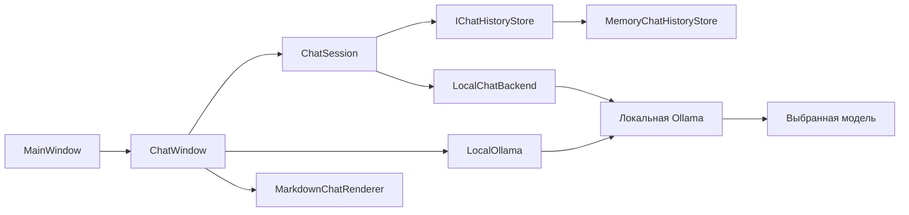

# DSP: устройство и использование локального чата

## 1. Назначение

DSP работает с локальными текстовыми моделями через **Ollama**.
Модель устанавливается пользователем на его компьютер. Приложение показывает
доступные модели, передаёт им сообщения и отображает ответы.
Облачные провайдеры, платные API и выбор сторонних серверов в интерфейсе не используются.

В проект входят:

- WPF-помощник с персонажем, контекстным меню и окном чата;
- библиотека бэкенда для отправки запросов и управления диалогом;
- терминальный клиент для отдельного запуска текстового чата.

Модель не включена в репозиторий. Приложение не устанавливает Ollama, не скачивает
веса и не обучает нейросеть. Доступ к функциям DSP через вызовы инструментов
модели пока не реализован: сейчас она получает текст и возвращает текст.

## 2. Требования

Для основного приложения нужны:

- Windows с поддержкой WPF;
- **.NET SDK 10** для сборки и запуска исходников;
- установленная Ollama;
- скачанная локальная модель с поддержкой текстового чата;
- достаточно памяти и свободного места для выбранной модели.

Проверка инструментов в терминале:

```powershell
dotnet --version
ollama --version
ollama list
```

Основное приложение нацелено на `net10.0-windows`, библиотека и терминал -
на `net10.0`. WPF-проект ссылается на библиотеку через `ProjectReference`.
Основной внешний пакет WPF-клиента - `Markdig` версии `1.6.0`, используемый
для разбора Markdown. В библиотеке бэкенда и терминале сторонних пакетов нет.

## 3. Установка Ollama и модели

1. Установите Ollama с [официального сайта](https://ollama.com/download/windows).
2. Запустите Ollama и откройте новый терминал, чтобы команда появилась в PATH.
3. Скачайте подходящую локальную модель. Например:

```powershell
ollama pull qwen3:4b-instruct
ollama list
```

Пример использует [Qwen3 4B Instruct](https://ollama.com/library/qwen3:4b-instruct).
Можно установить другую локальную текстовую модель Ollama; её требования
к памяти и возможности определяются самой моделью.

Веса остаются в хранилище Ollama вне проекта. Для скачивания нужен интернет;
локальная генерация использует установленную модель. Ключ API для этого
сценария не требуется.

Если Ollama не запущена, её можно запустить вручную:

```powershell
ollama serve
```

Этот терминал нужно оставить открытым. Если фоновая Ollama уже заняла порт,
второй сервер не нужен. Основное приложение также умеет запустить установленную
Ollama автоматически, как описано в разделе 8.

## 4. Запуск основного приложения

Откройте корень репозитория в VS Code. Терминал: **Terminal → New Terminal**.
Выполните:

```powershell
dotnet run --project dcp_project/dcp_project.csproj
```

Либо запустите отладку через F5 и выберите `dcp_project.csproj`, если редактор
предлагает несколько проектов. Файлы `*_wpftmp.csproj` - промежуточные файлы
сборки WPF, их выбирать не нужно.

При старте появляется персонаж, а список моделей подготавливается в фоне.
**Чат сам не открывается.** Нажмите правой кнопкой по персонажу и выберите
**«ЧАТ»** в крестовом меню.

Если установлена одна подходящая модель, она выбирается автоматически.
Если их несколько, выберите нужную в списке. После статуса **«Готово»**
можно отправлять сообщения.

## 5. Использование окна чата

| Элемент | Действие |
|---|---|
| Список моделей | Выбрать установленную локальную модель Ollama |
| «Обновить модели» | Повторно получить список после установки или удаления модели |
| Поле сообщения | Ввести текст одной строкой |
| Enter / «Отправить» | Отправить сообщение |
| «Отменить» | Отменить ожидание текущего ответа, не закрывая чат |
| «Очистить» | Явно очистить экранный диалог и историю текущей сессии |
| Крестик окна | Скрыть чат, сохранив текущий разговор в памяти |

Повторное нажатие «ЧАТ» открывает тот же экземпляр окна с сохранённым диалогом.
При смене модели сообщения **не удаляются**: новая модель получает текущую
историю. Имя автора пользовательских сообщений берётся из `Environment.MachineName`.
Ответы помощника подписаны **DSP**, независимо от выбранной модели.

Пока выполняется запрос, ввод, выбор модели, обновление списка и очистка
заблокированы. После завершения или отмены они снова доступны.
Отмена прерывает HTTP-запрос клиента, но не гарантирует мгновенную остановку
вычислений внутри Ollama.

Кнопки «Подключить» нет. Если подготовка закончилась ошибкой, устраните причину,
скройте окно крестиком и откройте его через «ЧАТ» либо обновите список моделей.

Чтобы завершить весь помощник, выберите **«ЗАКРЫТЬ»** в меню персонажа.
Просто закрыть окно чата недостаточно: помощник продолжает работать.

## 6. Форматирование ответов

Ответы DSP отображаются в `RichTextBox` через `FlowDocument`.
`MarkdownChatRenderer` разбирает текст с помощью Markdig и создаёт WPF-элементы.

Поддерживаются:

- **жирный текст**: `**текст**` и `__текст__`;
- *курсив*, заголовки и абзацы;
- маркированные, нумерованные и вложенные списки;
- цитаты и разделители;
- встроенный код и блоки кода;
- ссылки с адресами HTTP(S).

Код выводится моноширинным шрифтом; Markdown внутри него не обрабатывается.
Текст можно выделять и копировать. Подсветки синтаксиса, таблиц, формул
и диаграмм нет. Неподдерживаемые блоки сохраняются обычным текстом.

HTML не выполняется, изображения из ответов автоматически не скачиваются.
Файловые и другие схемы ссылок не запускаются. Разрешённая ссылка открывает
браузер только по действию пользователя.

Сообщения пользователя и служебные ошибки показываются буквально.
Форматирование ответа меняет только отображение: в истории остаётся исходная
строка ответа модели.

## 7. Структура проекта

```text
Chatbot/
  Backend/
    Chatbot.Backend.csproj
    IChatBackend.cs
    LocalChatBackend.cs
    ChatSession.cs
  Terminal/
    Chatbot.Terminal.csproj
    Program.cs
  TECHNICAL.md

dcp_project/
  App.xaml
  MainWindow.xaml
  MainWindow.xaml.cs
  ChatWindow.xaml
  ChatWindow.xaml.cs
  LocalOllama.cs
  MarkdownChatRenderer.cs
  PixelPerfectImage.cs
  CharacterSettingsWindow.xaml
  CharacterSettingsWindow.xaml.cs
  assets/
  dcp_project.csproj
```

| Компонент | Назначение |
|---|---|
| `App.xaml` | Запуск `MainWindow` через `StartupUri` |
| `MainWindow` | Персонаж, меню, создание скрытого чата и фоновая подготовка |
| `ChatWindow` | Выбор модели, отображение сообщений и действия пользователя |
| `LocalOllama` | Запуск установленной Ollama, список локальных моделей и прогрев |
| `MarkdownChatRenderer` | Преобразование Markdown в элементы WPF |
| `IChatBackend` | Контракт низкоуровневого текстового клиента |
| `LocalChatBackend` | HTTP-запросы, проверка параметров и разбор ответов Ollama |
| `ChatSession` | Модель и последовательная обработка ходов одного диалога |
| `IChatHistoryStore` | Граница подключения будущего хранилища сообщений |
| `MemoryChatHistoryStore` | Текущее хранение истории в памяти процесса |
| `Terminal/Program.cs` | Независимый консольный клиент |



## 8. Подключение и жизненный цикл Ollama

Параметры WPF-сценария находятся в `dcp_project/LocalOllama.cs`:

| Параметр | Значение |
|---|---|
| Сервер | `http://localhost:11434/` |
| Адрес текстового клиента | `http://localhost:11434/v1/` |
| Путь автозапуска | `%LOCALAPPDATA%\Programs\Ollama\ollama.exe` |
| Аргумент автозапуска | `serve` |
| Таймаут HTTP | 2 минуты |
| Предел отдельной проверки доступности | 1 секунда |
| Сохранение модели в памяти при прогреве | `keep_alive: "5m"` |

Смена сервера и пути установки через настройки окна пока отсутствует.
WPF не читает переменные окружения терминального клиента.

Последовательность работы:

1. `MainWindow_Loaded` создаёт `ChatWindow`, но не вызывает `Show()`.
2. `ChatWindow.PrepareAsync()` запускает асинхронную подготовку.
3. `LocalOllama.EnsureRunningAsync()` проверяет `GET /api/version`.
4. Если сервер не отвечает, запускается установленная `ollama.exe serve`
   без консольного окна.
5. До 30 раз проверяется готовность с паузой 500 мс между попытками.
   С учётом времени HTTP-проверок весь цикл может занять больше 15 секунд.
6. `GET /api/tags` возвращает установленные модели.
7. Текущий доступный выбор сохраняется. Единственная модель выбирается сама;
   при нескольких пользователь выбирает её в списке.
8. `PrepareModelAsync()` повторно проверяет выбор и отправляет пустой запрос
   генерации для загрузки весов в память.
9. После успеха разрешается отправка сообщений.

Фильтр списка допускает записи формата GGUF без указанных `remote_host`
и `remote_model`; теги `:cloud` и `-cloud` исключаются.
Список может содержать модель, не предназначенную для чата, например модель
эмбеддингов. Для переписки выбирайте модель текстовой генерации.

Во время подготовки повторный вызов не запускает вторую параллельную загрузку.
Неудачная подготовка не удаляет историю. Уже запущенный сервер не перезапускается.
Скачивание модели автоматически не выполняется.

Пустой запрос прогрева не становится сообщением диалога. `keep_alive` не
фиксирует модель в памяти навсегда: после простоя Ollama может выгрузить её,
а следующий запрос потребует повторной загрузки.

## 9. HTTP-взаимодействие

Все маршруты обслуживаются локальной Ollama.

| Метод и маршрут | Использование |
|---|---|
| `GET /api/version` | Проверить работу сервера |
| `GET /api/tags` | Получить модели и их метаданные для WPF |
| `POST /api/generate` | Загрузить выбранную модель пустым промптом |
| `GET /v1/models` | Получить идентификаторы моделей в низкоуровневом клиенте |
| `POST /v1/chat/completions` | Получить текстовый ответ на список сообщений |

Прогрев:

```json
{
  "model": "qwen3:4b-instruct",
  "prompt": "",
  "stream": false,
  "keep_alive": "5m"
}
```

Запрос диалога:

```json
{
  "model": "qwen3:4b-instruct",
  "messages": [
    { "role": "user", "content": "Привет!" }
  ],
  "stream": false
}
```

Бэкенд извлекает текст из `choices[0].message.content`. Пустое содержимое,
неправильная структура JSON и неуспешный HTTP-статус становятся ошибкой клиента.
Поля статистики, `finish_reason`, вызовы инструментов и потоковые события
не обрабатываются. Параметры генерации вроде температуры и лимита ответа
из приложения не передаются: действуют настройки Ollama и модели.

Бэкенд принимает только абсолютные HTTP(S)-адреса loopback: `localhost`,
`127.0.0.1` или `[::1]`. Логин, пароль, query-параметры и фрагмент URI запрещены.
Завершающий `/` нормализуется, путь `/v1/` автоматически не добавляется.
Стандартный HTTP-обработчик не следует перенаправлениям.

## 10. История диалога и подготовка к БД

История принадлежит **разговору**, не модели. При переключении модели
`ConversationId` и сохранённые сообщения остаются прежними.

`ChatSession` получает при создании:

- экземпляр `IChatBackend`;
- реализацию `IChatHistoryStore`;
- непустой идентификатор разговора.

При отправке сессия читает историю, создаёт список с новым сообщением,
получает ответ и добавляет успешную пару в хранилище. Семафор упорядочивает
отправку, выбор модели и явную очистку. Ошибочные и отменённые ходы
в историю не добавляются.

Автоматического удаления старых сообщений нет. Сейчас в запрос передаётся
весь разговор. Его длина может превысить контекст модели; ограничение по токенам,
сжатие истории и извлечение давних фактов ещё не реализованы.

Видимая история отличается от памяти модели: сообщение пользователя появляется
на экране сразу. При ошибке рядом показывается пояснение, но эта неуспешная
пара не передаётся модели в следующих запросах.

Текущее хранилище - `MemoryChatHistoryStore`. Оно держит сообщения в памяти
процесса и возвращает их копии. После завершения приложения данные теряются.
Скрытие окна чата их не удаляет. «Очистить» - отдельное явное действие пользователя.

Для подключения БД команда реализует интерфейс:

```csharp
public interface IChatHistoryStore
{
    Task<IReadOnlyList<ChatMessage>> ReadAsync(
        string conversationId, CancellationToken cancellationToken = default);

    Task AppendTurnAsync(
        string conversationId, ChatMessage user, ChatMessage assistant,
        CancellationToken cancellationToken = default);

    Task ClearAsync(
        string conversationId, CancellationToken cancellationToken = default);
}
```

Хранилище должно сохранять порядок и атомарно добавлять пару сообщений.
Для восстановления разговора нужно передать существующий ID и постоянное
хранилище. Сейчас окно создаёт новый UUID при запуске. Схема БД, миграции,
выбор сохранённого диалога и постоянное хранение ID в эту реализацию не входят.

## 11. C#-интерфейс бэкенда

Пространство имён - `Dsp.Chatbot`.

```csharp
public sealed record ChatMessage(string Role, string Content);

public interface IChatBackend
{
    Task<IReadOnlyList<string>> GetModelsAsync(
        CancellationToken cancellationToken = default);

    Task<string> ReplyAsync(
        string model, IReadOnlyList<ChatMessage> messages,
        CancellationToken cancellationToken = default);
}
```

Роли: `system`, `user`, `assistant`. Пустая модель, пустой список, неподдерживаемая
роль и пустое содержимое сообщения отклоняются до запроса.
Низкоуровневый клиент не хранит историю; для неё используется `ChatSession`.

Пример создания сессии в асинхронном методе:

```csharp
using Dsp.Chatbot;

using var backend = new LocalChatBackend("http://localhost:11434/v1/");
var store = new MemoryChatHistoryStore();
var session = new ChatSession(backend, store, Guid.NewGuid().ToString());
await session.SelectModelAsync("qwen3:4b-instruct");

try
{
    string reply = await session.ReplyAsync("Помоги составить план дня.");
    // Отобразить reply средствами интерфейса.
}
catch (ChatBackendException exception)
{
    // Показать понятную ошибку подключения или ответа сервера.
}
```

Этот пример предполагает, что Ollama уже запущена и модель установлена.
Сам конструктор бэкенда сервер не запускает. Не создавайте клиент заново
на каждое сообщение. В UI используйте `await`, а не `.Result` или `.Wait()`.
Для отмены передавайте `CancellationToken`.

`LocalChatBackend` реализует `IDisposable` и владеет своим `HttpClient`.
Дополнительный параметр `HttpMessageHandler` позволяет подставлять транспорт
в тестах; переданный обработчик также освобождается вместе с клиентом.
Необязательный параметр `apiKey` низкоуровневого конструктора сохранён для
совместимости контракта, но WPF и терминал его не используют. Управляющие
символы в нём отклоняются, значение не выводится в сообщениях ошибки.

## 12. Терминальный клиент

Терминал нужен для проверки бэкенда независимо от WPF. Перед запуском
Ollama должна работать. Команды из корня репозитория:

```powershell
$env:DSP_CHAT_BASE_URL = "http://localhost:11434/v1/"
$env:DSP_CHAT_MODEL = "qwen3:4b-instruct"
dotnet run --project Chatbot/Terminal/Chatbot.Terminal.csproj
```

Если переменные не заданы, программа спросит адрес и модель. Адрес по Enter -
`http://localhost:11434/v1/`. `DSP_CHAT_API_KEY` терминалом не используется.
Переменные задаются в текущем процессе PowerShell, не сохраняются приложением
в файлы и не изменяют параметры WPF.

| Команда | Действие |
|---|---|
| `/models` | Получить список идентификаторов через текстовый API Ollama |
| `/model имя` | Сменить модель, сохранив разговор |
| `/clear` | Явно очистить историю |
| `/exit` | Завершить клиент |
| Ctrl+C | Отменить активную работу и завершить клиент |

Терминал получает обычный список сервера через `/v1/models`; фильтр локальных
записей WPF из `/api/tags` здесь не применяется. Выбирайте установленную локальную
модель, а не облачный тег Ollama. Команда `/model` не скачивает модель и не
проверяет её заранее: ошибка проявится на следующем запросе.

Команды чувствительны к регистру. Обычный ввод читается одной строкой,
пробелы по краям удаляются. История хранится самим терминалом в памяти,
не очищается при смене модели и не обрезается по числу сообщений.
Markdown в консоли отображается исходным текстом; форматирование реализовано
в графическом клиенте.

## 13. Закрытие и отмена

Крестик `ChatWindow` скрывает окно и отменяет текущую отправку, не завершая
помощника. Подготовка модели при скрытии продолжается.

При завершении главного окна вызывается `ChatWindow.Shutdown()`:

1. Устанавливается признак завершения.
2. Отменяется общий токен.
3. Чат действительно закрывается.
4. После окончания задач подготовки и отправки освобождаются клиент и токен.

Освобождение запускается асинхронно, не блокируя закрытие главного окна.
Ollama отдельно не останавливается; выгрузкой модели управляет её сервер.

## 14. Отображение персонажа

`MainWindow` - прозрачное окно без рамки и кнопки на панели задач, поверх
остальных окон. Левой кнопкой персонаж перетаскивается, правой открывается меню.
Выбор персонажа хранится только на время запуска.

Изображения `base`, `maid`, `gyro` имеют размеры 17×23, 18×23 и 22×23 пикселя.
Контрол занимает 300×300 с сохранением пропорций. Для резкого увеличения
пиксельных изображений заданы:

```xml
RenderOptions.BitmapScalingMode="NearestNeighbor"
SnapsToDevicePixels="True"
UseLayoutRounding="True"
```

Новых деталей при увеличении не появляется. При нецелом масштабе ширина
экранных пикселей может немного отличаться. `PixelPerfectImage` отдельно
проверяет попадание мыши по альфа-каналу с порогом больше 10.
Изображения с суффиксом `_sost` в переключении состояний пока не используются.

## 15. Сборка и диагностика

```powershell
dotnet build dcp_project/dcp_project.csproj
dotnet build Chatbot/Terminal/Chatbot.Terminal.csproj
```

Зависимости восстанавливаются из описаний проектов. Для отдельной папки сборки:

```powershell
dotnet build dcp_project/dcp_project.csproj --artifacts-path .local/ui-build
```

Этот вызов не обновляет работающий процесс и не перенастраивает F5.

| Проблема | Что проверить |
|---|---|
| `dotnet` не найден | Установлен ли SDK 10; открыт ли новый терминал |
| Проект не найден | Запущена ли команда из корня; правильный ли путь к `.csproj` |
| Ошибка запуска `.ps1` | Использовать прямые команды выше, не менять политику защиты |
| Не найдена Ollama | Установить её или запустить сервер вручную |
| Нет моделей | `ollama list`, установка модели, «Обновить модели» |
| Модель не грузится | Наличие весов, свободная память, журнал Ollama |
| HTTP 404 | Адрес, путь `/v1/` и точное имя модели |
| HTTP 400 | Поддерживает ли модель чат; не превышен ли контекст |
| Таймаут | Загрузка модели, занятость GPU/CPU, длина запроса; предел клиента 2 минуты |
| Неверный JSON / нет текста | Совместимость ответа сервера с ожидаемой структурой |
| Файлы EXE / DLL заняты | Закрыть помощника через «ЗАКРЫТЬ» и остановить отладку |
| Нет `.baml` в `obj/` | При закрытом приложении выполнить пересборку |

Пересборка WPF:

```powershell
dotnet build dcp_project/dcp_project.csproj --target:Rebuild
```

При Build Failures не запускайте старую сборку вместо новой.
Закрытие чата крестиком не освобождает файлы всего приложения.

Для проверки сервера:

```powershell
ollama list
ollama ps
Invoke-RestMethod -Uri "http://localhost:11434/api/version"
```

Ошибки соединения, HTTP и разбора ответа оборачиваются в `ChatBackendException`.
Ошибки параметров - `ArgumentException`, отмена - `OperationCanceledException`.
Тело HTTP-ошибки не выводится целиком. Автоматического повтора отправки нет.

## 16. Границы реализации

- Только локальная текстовая переписка через Ollama.
- Нет выполнения функций DSP по запросу модели и обработки `tool_calls`.
- Нет постоянной БД, восстановления диалога после перезапуска и долговременной памяти.
- Нет отбора контекста по токенам: отправляется вся сохранённая история.
- Ответ ожидается целиком, без потокового показа.
- `finish_reason` и статистика генерации не возвращаются вызывающему интерфейсу.
- Нет отдельного прикладного лимита размера HTTP-ответа.
- Нет экранов настройки адреса сервера, пути установки и параметров генерации.
- Нет автоматического скачивания или установки моделей.

## 17. Проверка работы

После сборки выполните ручную проверку:

1. Запустите помощника: персонаж виден, чат скрыт.
2. Откройте «ЧАТ», дождитесь загрузки списка и выберите модель.
3. Отправьте сообщение и получите ответ DSP.
4. Попросите запомнить короткое число, затем спросите его в следующем сообщении.
5. При наличии второй модели переключитесь и проверьте передачу контекста.
6. Попросите ответ с `**жирным текстом**`, списком и блоком кода.
7. Проверьте отмену запроса и последующую отправку.
8. Скройте чат и откройте снова: диалог должен сохраниться.
9. Явно очистите диалог и завершите помощника через «ЗАКРЫТЬ».

Локальные автоматические проверки находятся вне публикуемой части проекта.
Их наличие не означает, что `dotnet test` воспроизводит их на другом компьютере.
Ответы LLM недетерминированы; тест одного разговора не гарантирует качество модели.

## 18. Файлы репозитория

В Git включаются исходники, `.csproj`, ресурсы персонажей, `.gitignore`
и проектная документация, в том числе этот файл.

Не включаются веса моделей, установка Ollama, результаты `bin/` и `obj/`,
локальные БД, личные разговоры, ключи, отчёты, памятки и служебные файлы агента.
Папка `.local/` предназначена только для локальной работы и исключена из Git.

Другой участник самостоятельно устанавливает Ollama, скачивает модель и запускает
проект по этому руководству. Личные пути разработчика и его служебные скрипты
для этого не требуются.

## 19. Документация используемых инструментов

- [.NET 10 SDK](https://dotnet.microsoft.com/download/dotnet/10.0).
- [Ollama на Windows](https://docs.ollama.com/windows).
- [Список моделей Ollama](https://docs.ollama.com/api/tags).
- [Генерация и загрузка модели](https://docs.ollama.com/api/generate).
- [Markdig](https://github.com/xoofx/markdig).
