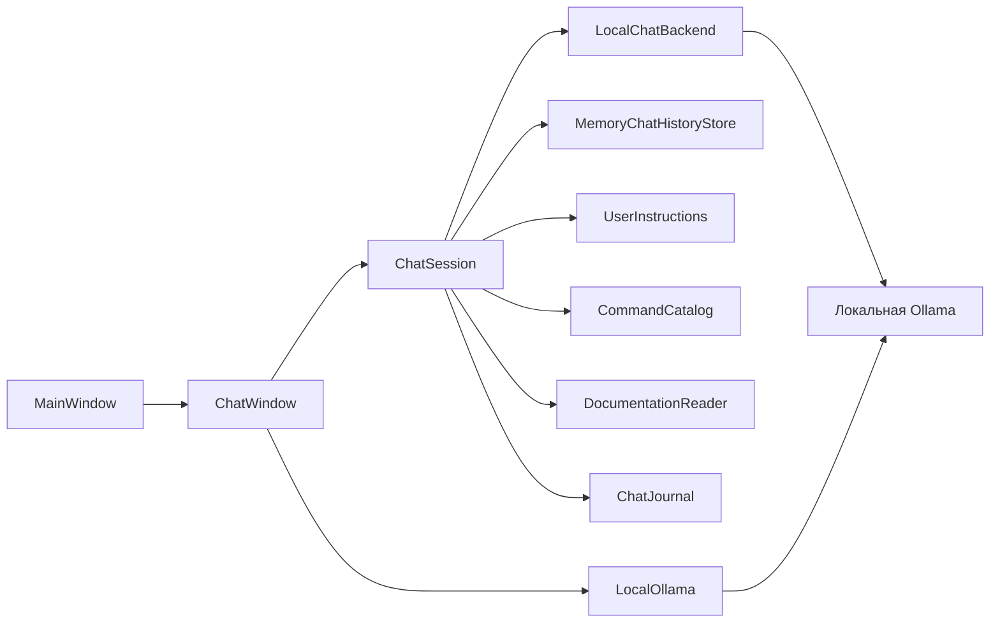

# DSP: архитектура, настройка и использование чата

## 1. Назначение

DSP — настольный помощник на C# и WPF. Чат работает с установленной на
компьютере моделью через локальную Ollama. Веса не входят в репозиторий;
приложение их не скачивает и не обучает модель. Облачные модели не поддерживаются.

Этот файл — основное руководство по чат-боту. Устройство SQLite описано
отдельно в [документации БД](../dcp_project/Data/DATABASE_TECHNICAL.md).
Корневой README описывает общий замысел проекта, включая будущие возможности.

## 1.1. Роль помощника и функции DSP

DSP (Desktop Support Personality) помогает с повседневными вопросами
и использованием функций приложения. Его роль — личный настольный помощник.
Чтение справки помогает узнать функции, но не делает DSP помощником по программированию.

Доступно в интерфейсе:

- **Чат:** правой кнопкой по персонажу → «ЧАТ». Выбор локальной модели,
  переписка, отмена запроса, секундомер и форматирование Markdown.
- **Плеер:** добавление MP3 перетаскиванием в левую зону «ПЛЕЕР» рядом
  с персонажем или на кнопку плеера. Меню персонажа → наведение на «ПЛЕЕР» →
  выбор трека. Есть пауза, предыдущий/следующий трек, скорость 1×/2×
  и перемотка на 10 секунд. Плейлист хранится на время запуска.
- **Буфер:** перетащите текст, изображение или файл в правую зону «БУФЕР».
  Кнопка «БУФЕР» открывает до 20 записей. Можно удалить выбранное,
  очистить список и перетащить записи в другое приложение.
- **Персонаж:** перемещение левой кнопкой, меню правой кнопкой,
  выбор одного из трёх обликов через «ПЕРСОНАЖ». «ЗАКРЫТЬ» завершает весь DSP.

Бот может объяснять эти действия по документации. Самостоятельное управление
плеером, буфером, задачами и расписанием через модель пока не подключено.
Сейчас исполняется только внутреннее чтение справки `dsp.docs.read`.
В проекте есть отдельный слой SQLite, но он не сохраняет переписку и не
передаёт факты или промпты в чат. Голосовой ввод, TTS и долгосрочная память
диалога пока не подключены.

## 2. Требования и быстрый запуск

Для сборки основного приложения нужны Windows, .NET SDK 10, установленная
Ollama и скачанная локальная модель текстового чата. WPF использует
`net10.0-windows`; Backend и Terminal — `net10.0`.

Проверка инструментов и установка примера модели:

```powershell
dotnet --version
ollama --version
ollama pull qwen3:4b-instruct
ollama list
```

Из корня репозитория:

```powershell
dotnet run --project dcp_project/dcp_project.csproj
```

При необходимости запустите Ollama отдельно командой `ollama serve`.
Если сервер уже работает, второй запуск сервера не нужен. Приложение умеет
само запускать Ollama из стандартного пути установки на Windows (раздел 5).
Ключ API не требуется. Интернет нужен для первоначального скачивания модели,
а установленная локальная модель выполняет генерацию на компьютере.

При старте появляется персонаж; чат создаётся и подготавливается скрытым.
Откройте его через меню «ЧАТ». Если найдена одна локальная модель, она
выбирается автоматически; при нескольких её выбирает пользователь.
После загрузки DSP один раз генерирует приветствие. Можно отменить его
через «Стоп». После ошибки/отмены приветствие автоматически не повторяется.

Локальный ярлык автосборки на компьютере разработчика необязателен:
другие участники запускают приложение приведённой командой.
В VS Code для запуска выбирайте `dcp_project.csproj`, а не `*_wpftmp.csproj`.

## 3. Использование окна чата

| Элемент | Назначение |
|---|---|
| Список моделей | Выбрать установленную локальную модель Ollama |
| «Обновить модели» | Повторно получить список и подготовить выбранную модель |
| Поле ввода, Enter / «Отправить» | Отправить однострочное сообщение |
| «Стоп» | Отменить текущий запрос, включая ожидание приветствия или чтение справки |
| «Очистить» | Удалить видимую переписку и историю текущей сессии |
| `Время запроса: 00:00.000` | Минуты, секунды и миллисекунды полного запроса |
| «Инструкции поведения» | Открыть личный файл настроек в Блокноте |
| «—» в заголовке | Свернуть чат без остановки работы |
| Края и углы окна | Изменить размеры; минимум 380×320 |

Во время запроса отправка, выбор модели, обновление списка и очистка
заблокированы. «Стоп» остаётся доступной. Ссылка на настройки тоже доступна:
изменение файла повлияет на следующий запрос, а не на уже отправленный.

Сворачивание сохраняет сессию и текущую отправку. Если закрытие вызвано
Alt+F4 или программно, окно скрывается без отмены запроса. Меню «ЧАТ»
возвращает тот же экземпляр окна. При смене модели история не удаляется.
Приветствие при повторном открытии, переключении или очистке не запускается.

В заголовке нет кнопок закрытия и разворачивания. Персонаж → «ЗАКРЫТЬ»
завершает всё приложение и отменяет активные операции. Отдельного сервиса,
иконки в трее или автозапуска при входе в Windows нет.

Время измеряется `Stopwatch`; отображение обновляется примерно раз в 16 мс,
с учётом занятости интерфейса. Это время всего запроса, а не отдельного
внутреннего «размышления» модели. Предварительная подготовка списка моделей
в этот счётчик не входит. По завершении остаётся итоговое время.

## 4. Архитектура и файлы

```text
Chatbot/
  Backend/
    IChatBackend.cs            — ChatMessage, контракт клиента, исключение
    LocalChatBackend.cs        — HTTP-клиент Ollama
    OllamaModelCatalog.cs      — получение и фильтр локальных моделей
    ChatSession.cs             — последовательная обработка диалога и хранилище RAM
    CommandCatalog.cs          — каталог команд, системная инструкция, разбор ответа
    DocumentationReader.cs     — справка в памяти приложения
    UserInstructions.cs        — личный файл поведения
    ChatJournal.cs             — единый журнал запуска
    Chatbot.Backend.csproj
  Terminal/
    Program.cs
    Chatbot.Terminal.csproj
  commands.json               — доступные/планируемые команды
  behavior.txt                — начальный шаблон поведения
  TECHNICAL.md

dcp_project/
  App.xaml / App.xaml.cs       — запуск MainWindow
  MainWindow.xaml / .cs        — персонаж, меню, плеер, добавление в буфер
  ChatWindow.xaml / .cs        — интерфейс чата, секундомер, отмена
  LocalOllama.cs               — запуск сервера, список моделей, прогрев
  MarkdownChatRenderer.cs      — Markdown → WPF FlowDocument
  BehaviorFileLink.cs          — открытие фиксированного файла настроек
  BufferWindow.xaml / .cs      — окно буфера
  BufferItem.cs
  CharacterSettingsWindow.*
  PixelPerfectImage.cs
  Data/                       — отдельный слой SQLite
  assets/                     — изображения персонажей
  dcp_project.csproj
```



WPF и Terminal ссылаются на Backend через `ProjectReference`.
Backend и Terminal не используют внешние NuGet-пакеты. WPF подключает
Markdig 1.6.0 для Markdown и Microsoft.Data.Sqlite 11.0.0 для слоя данных.

## 5. Сервер и модели Ollama

| Параметр WPF | Значение |
|---|---|
| Сервер | `http://localhost:11434/` |
| Адрес текстового API | `http://localhost:11434/v1/` |
| Путь автозапуска | `%LOCALAPPDATA%\Programs\Ollama\ollama.exe` |
| Аргумент | `serve`, без консольного окна |
| Таймаут HTTP | 2 минуты на отдельный вызов |
| Проверка доступности | До 1 секунды на попытку |
| Прогрев | Пустой `POST /api/generate`, `keep_alive: "5m"` |

Подготовка WPF: проверить файл поведения и каталог → `GET /api/version` →
при необходимости запустить сервер → до 30 проверок с интервалом 500 мс →
`GET /api/tags` → выбрать модель → проверить выбор ещё раз → прогреть её.
С учётом времени проверок запуск может занимать больше 15 секунд.

Общий фильтр `OllamaModelCatalog.IsLocalModel` принимает записи с непустым
именем, `details.format == "gguf"`, без `remote_host`/`remote_model` и без
суффиксов `:cloud` или `-cloud`. Терминал проверяет локальный список также
перед отправкой и сменой модели. WPF проверяет его при выборе/прогреве.
Фильтр не проверяет способность модели к чату: embedding-модель может
появиться в списке, но запрос переписки к ней завершится ошибкой.

Адрес/путь установки WPF пока задаются в `LocalOllama.cs`, отдельного экрана
настройки нет. Переменные окружения Terminal на WPF не влияют. DSP не
останавливает сервер Ollama при выходе; сервер сам управляет выгрузкой модели.

## 6. Запрос, ответ и история

`ChatSession` получает backend, хранилище, ID разговора и необязательные
пути каталога/поведения и журнал. Семафор упорядочивает отправку, выбор
модели и очистку. При обычной отправке:

1. Перечитать `commands.json` и один раз прочитать актуальный файл поведения.
2. Сформировать сообщение `system`: протокол, команды, поведение, краткие
   возможности и оглавление справки. Старое `system` в истории не накапливается.
3. Прочитать успешную историю и добавить текущее сообщение пользователя.
   К запросу также прикладывается открытый текст настроек, чтобы модель
   могла пересказывать его, не принимая за закрытый промпт.
4. Записать запрос в журнал и отправить `POST /v1/chat/completions`.
5. Разобрать JSON из `choices[0].message.content`. При `dsp.docs.read`
   прочитать справку, передать результат модели и получить финальный ответ.
6. Сохранить успешную пару: исходный текст пользователя и сырой финальный
   ответ модели. Показать пользователю поле `text` с Markdown.

Первый запрос модели выглядит так:

```json
{
  "model": "qwen3:4b-instruct",
  "messages": [
    { "role": "system", "content": "Инструкция DSP и справка" },
    { "role": "user", "content": "Настройки пользователя и его сообщение" }
  ],
  "stream": false,
  "response_format": { "type": "json_object" }
}
```

Ожидаемый текстовый конверт модели:

```json
{ "text": "Ответ с **форматированием**", "command": null }
```

Обычный текст без распознанного конверта остаётся текстом, никогда не
исполняется. Команда без поля `text` тоже распознаётся, если она корректна.
Неизвестные/выключенные команды и неправильные `arguments` отклоняются.

История хранится в `MemoryChatHistoryStore`, отдельно по `ConversationId`.
Смена модели и сворачивание её сохраняют; после завершения процесса она
теряется. Журнал не используется для восстановления памяти. Ошибочный или
отменённый ход в историю не записывается, хотя сообщение пользователя уже
может быть видно в окне. Первый служебный запрос приветствия скрыт из ленты,
но успешная пара присутствует в истории и журнале.

В запрос уходит вся история. Подсчёта токенов, сжатия и автоматического
удаления старых сообщений нет: длинный разговор, большая справка или файл
поведения могут превысить контекст модели и вызвать HTTP 400. Успешный
диалог в одном тесте не гарантирует неограниченную длину разговора.

Отмена действует на HTTP-ожидание клиента и последующую обработку. Она не
гарантирует немедленного прекращения вычислений внутри Ollama. Автоматической
повторной отправки нет. Для работы со справкой выполняется не больше двух
HTTP-генераций на один ход; второе предложение команды не запускается.

## 7. Каталог команд и граница модулей

Исходный каталог — `Chatbot/commands.json`. При сборке он копируется рядом
с EXE/DLL. Программа читает копию из `AppContext.BaseDirectory` перед каждым
ходом. Для применения правки исходника пересоберите приложение; правка
выходной копии действует со следующего запроса.

```json
{
  "version": 1,
  "commands": [
    {
      "name": "module.action",
      "description": "Описание будущей команды",
      "enabled": false,
      "parameters": { "type": "object", "properties": {} }
    }
  ]
}
```

Требуются версия 1, непустые уникальные имена, описания и объект `parameters`.
В инструкцию попадают только включённые команды. Включение записи не создаёт
исполнителя. Для будущих команд модель может только сформировать предложение:

```json
{ "text": "Предлагаю действие", "command": { "name": "module.action", "arguments": {} } }
```

Для сторонних команд проверяются включённое имя и объект аргументов,
но полная JSON Schema пока не исполняется. Предложение записывается как
`command_proposed_not_executed`, а пользователь видит, что действия не было.
Единственный подключённый обработчик — `dsp.docs.read` с отдельной проверкой
аргументов. Систему модулей, очередь инициализации и исполнителя Андрея
этот код не заменяет. Запуска PowerShell/cmd и обмена stdin/stdout/stderr нет.

## 8. Документация в памяти

При сборке Backend явно включает три документа:

- `README.md`;
- `Chatbot/TECHNICAL.md`;
- `dcp_project/Data/DATABASE_TECHNICAL.md`.

`DocumentationReader` загружает их в память процесса. Раздел **1.1** этого
руководства даёт краткий обзор функций; заголовки второго уровня образуют
оглавление с номерами строк. Они передаются модели в каждом запросе.
Нужный подробный фрагмент модель получает через внутреннюю команду:

```json
{
  "text": "Посмотрю в справке",
  "command": {
    "name": "dsp.docs.read",
    "arguments": { "path": "Chatbot/TECHNICAL.md", "query": "плеер" }
  }
}
```

`path` должен точно совпадать со списком. Можно передать `startLine` (с 1)
и `lineCount` (1–200, по умолчанию 120). `query` ищет первое вхождение
слова/фразы без учёта регистра и возвращает до 35 строк рядом с ним;
в этом режиме начальная строка определяется поиском. Неизвестные аргументы
и пути отклоняются. Ненайденное слово не доказывает отсутствия функции.

Результат содержит путь, число строк и текст. Он передаётся модели как
справочные данные перед финальным ответом, но не накапливается в истории.
Сохраняются только в журнале команда, прочитанный фрагмент и запрос с ним.
Это простой поиск по справке, не векторная БД, не обучение весов и не
долгосрочная память разговора. Исходники и произвольные файлы не читаются.
Выбор команды остаётся за моделью: она может ответить по краткому обзору
и не запросить подробный документ даже после просьбы. Наличие обработчика
не гарантирует, что любая модель правильно выберет его и сформирует аргументы.

Для новой техдоки/README добавьте явный `EmbeddedResource` в
`Chatbot.Backend.csproj`, затем пересоберите приложение. Автопоиска будущих
документов по диску нет. Устаревший `Chatbot/README.md` удалён; описание чата одно.

## 9. Поведение и ссылка на настройки

Личный файл:

```text
%LOCALAPPDATA%\DesktopSupportPersonality\behavior.local.txt
```

При первом запуске он создаётся из `Chatbot/behavior.txt`. Общий шаблон
входит в Git, личный файл — нет. Обновление шаблона не стирает существующие
пожелания пользователя. Для возврата к шаблону можно удалить личный файл
при закрытом DSP и запустить приложение заново.

Нажмите «Инструкции поведения» в чате, отредактируйте текст в Блокноте
и сохраните в UTF-8. Следующий запрос прочитает новый текст. Пересборка,
перезапуск и очистка истории не требуются. Уже идущий запрос использует
единую ранее прочитанную версию. Журнал фиксирует `behavior_loaded` и
`behavior_updated`. Это перечитывание перед отправкой, не фоновый FileSystemWatcher.

В файле можно задавать тон, обращение, краткость, юмор и другие черты.
Настройки открыты: пользователь может попросить модель процитировать
или пересказать их. Они меняют инструкции, но не веса, реальные функции
или права программы. Следование роли зависит от модели; небольшая Qwen
может повторяться, спорить или неверно интерпретировать пожелания. Файл
не гарантирует любое поведение и не заменяет проверку качества модели.

Бот может дать ссылку в своём ответе:

```markdown
[Инструкции поведения](dsp://settings/behavior)
```

WPF обрабатывает только этот точный внутренний адрес. По нажатию пользователя
`BehaviorFileLink` открывает фиксированный `behavior.local.txt` через Notepad;
модель не выбирает путь или программу. Другие `dsp://` и ссылки `file://`
не запускаются. В терминале такая ссылка остаётся обычным текстом.

## 10. Журнал работы

```text
%LOCALAPPDATA%\DesktopSupportPersonality\dsp-work.txt
```

На новый запуск создаётся/очищается один фиксированный UTF-8-файл, после чего
записи дописываются в него. Сворачивание, выбор модели и очистка диалога
журнал не сбрасывают. WPF и Terminal используют одинаковый путь: одновременный
запуск нескольких клиентов может смешать записи или очистить чужой текущий журнал.

В файле есть время UTC, ID разговора, тип события и читаемый JSON данных:
выбор модели, загрузка/изменение поведения, запросы, сырые ответы, предложение
команды, начало/результат чтения справки, отмена, ошибки, очистка истории.
Скрытые внутренние рассуждения модели не извлекаются. Файл содержит открытый
текст переписки и настроек; он не отправляется в Git и не служит памятью модели.
Ошибки записи не останавливают чат; пользователь получает предупреждение.

Кнопки «Режим разработчика» нет. Журнал можно читать обычным редактором.
Не копируйте в репозиторий личный файл поведения или журнал: оба имени
дополнительно включены в `.gitignore`.

## 11. Терминал и C#-контракты

Перед запуском Terminal Ollama должна уже работать. Из корня репозитория:

```powershell
$env:DSP_CHAT_BASE_URL = "http://localhost:11434/v1/"
$env:DSP_CHAT_MODEL = "qwen3:4b-instruct"
dotnet run --project Chatbot/Terminal/Chatbot.Terminal.csproj
```

Без переменных программа спросит адрес и модель. Адрес по Enter — тот же
локальный порт 11434. `DSP_CHAT_API_KEY` не используется. `/models` показывает
локальные установленные записи; `/model имя` проверяет выбор и сохраняет
историю; `/clear` очищает её; `/exit` и Ctrl+C завершают клиент. Команды
чувствительны к регистру. Markdown и внутренняя ссылка в консоли не оформляются.

Пространство имён Backend — `Dsp.Chatbot`:

```csharp
public sealed record ChatMessage(string Role, string Content);

public interface IChatBackend
{
    Task<IReadOnlyList<string>> GetModelsAsync(CancellationToken cancellationToken = default);
    Task<string> ReplyAsync(string model, IReadOnlyList<ChatMessage> messages,
        CancellationToken cancellationToken = default);
}
```

`LocalChatBackend` — низкоуровневый клиент: `GetModelsAsync` читает `/v1/models`
без фильтра метаданных; интерфейсы приложения используют `OllamaModelCatalog`
или `LocalOllama`. Сам backend не запускает сервер и не хранит историю.
Принимаются только абсолютные HTTP(S)-адреса loopback без userinfo, query
и fragment; завершающий `/` нормализуется, `/v1/` автоматически не добавляется.
Перенаправления стандартным обработчиком запрещены.

Конструктор принимает необязательные `apiKey`, `HttpMessageHandler`
и `jsonResponses` (по умолчанию false). WPF и Terminal включают JSON-режим,
но не используют ключ. Backend владеет клиентом и обработчиком; его нужно
освобождать через `Dispose`. Допустимые роли — system, user, assistant;
пустые сообщения и неправильные параметры отклоняются.

`ChatSession` получает `IChatHistoryStore` с методами `ReadAsync`,
`AppendTurnAsync` и `ClearAsync`. Для подключения БД нужен адаптер с атомарной
записью пары, таблицы разговоров/сообщений и восстановление ConversationId.
В `DatabaseService` сейчас таких таблиц и адаптера нет. `UserFactMemory`
хранит отдельные факты, `SystemPrompt` — записи инструкций; их применение
к чату также требует отдельного сборщика контекста с учётом IsActive/Scale/SortOrder.

## 12. Markdown и отображение

Ответ DSP оформляется Markdig → WPF FlowDocument в RichTextBox. Поддержаны
жирный/курсив, заголовки, абзацы, списки и вложенность, цитаты, разделители,
встроенный код, блоки кода и HTTP(S)-ссылки. Код не исполняется; HTML отключён,
изображения из ответа не скачиваются. Таблицы, формулы, диаграммы и подсветка
синтаксиса не реализованы. Неподдерживаемое оформление остаётся текстом.
Пользовательские сообщения и ошибки показываются буквально.

Пользователь подписан именем компьютера, помощник — DSP. Для пиксельных
персонажей задан NearestNeighbor, SnapsToDevicePixels и UseLayoutRounding.
Они сохраняют резкие края, но не добавляют детализацию маленьким PNG.

## 13. Сборка и диагностика

```powershell
dotnet build dcp_project/dcp_project.csproj
dotnet build Chatbot/Terminal/Chatbot.Terminal.csproj
dotnet test dcp_project.Tests/dcp_project.Tests.csproj
```

Файла решения в корне нет: указывайте проект явно. Не запускайте старую
сборку после Build Failures. Если EXE/DLL заняты, закройте весь DSP через
меню персонажа. Для отдельного каталога проверки:

```powershell
dotnet build dcp_project/dcp_project.csproj --artifacts-path .local/check-build
```

| Симптом | Проверка |
|---|---|
| Нет dotnet | Установить SDK 10, открыть новый терминал |
| Ollama не найдена | Установить в стандартный путь или запустить сервер вручную |
| Список пустой | `ollama list`, установка локальной модели, обновление списка |
| Модель не отвечает | Поддержка чата, память GPU/CPU, точное имя и журнал Ollama |
| HTTP 400 на длинном диалоге | Размер контекста модели и объём истории/инструкций/справки |
| HTTP 404 | Правильный порт, `/v1/` и имя модели |
| Таймаут | Прогрев, занятость модели, длина запроса; предел отдельного вызова — 2 минуты |
| Поведение не такое, как в файле | Сохранён ли правильный личный файл; события behavior_updated; ограничения самой модели |
| Неверный JSON | Поддержка JSON-формата выбранной моделью |

`ChatBackendException` обозначает сетевую/серверную ошибку, `ArgumentException`
— параметры, `OperationCanceledException` — отмену. Тело HTTP-ошибки целиком
не показывается. Необработанный формат ответа не превращается в команду оболочки.

Минимальная ручная проверка: открыть чат → получить приветствие → отправить
две связанные реплики → свернуть во время ответа и вернуть окно → отменить
запрос и отправить следующий → изменить поведение без перезапуска → попросить
помощь с плеером по справке → открыть ссылку настроек → проверить Markdown
и растягивание окна → завершить DSP и проверить сброс журнала при новом запуске.

Опубликованный `dcp_project.Tests` содержит пустой Test1: его успешный запуск
не доказывает корректность функций. Локальные проверки разработчика не входят
в репозиторий и не воспроизводятся обычным `dotnet test` на другом компьютере.

## 14. Состав Git и границы готовности

В Git входят исходники, проекты, PNG-ресурсы, JSON-каталог, общий шаблон
поведения и документация. Не входят модели, установка Ollama, bin/obj,
локальные БД, `.local`, личные настройки, переписка, журнал и ярлык компьютера.
`.gitignore` не удаляет уже отслеживаемые файлы: это проверяется отдельно.

Текущая реализация — локальный чат с настраиваемым поведением, справкой,
журналом и интерфейсом. Нет исполнения модулей через модель, потоковой
генерации, БД переписки, постоянного восстановления диалога, отбора контекста
по токенам и гарантии точного следования всем чертам персонажа. Возможности
модели и качество её ответов нужно отличать от возможностей самого приложения.
